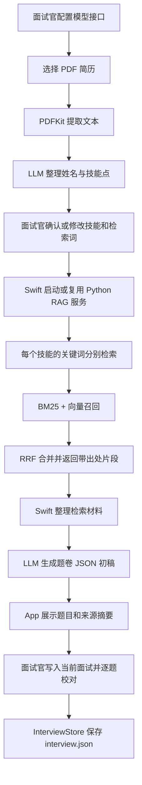

# InterviewDesk 系统业务流程与代码详解

本文从面试官实际使用流程出发，说明 InterviewDesk 如何把候选人简历变成一份带依据、可校对的题卷，并沿数据流讲解 SwiftUI 桌面端与 Python RAG 服务中的关键代码。

> 代码路径均以仓库根目录为基准。代码片段为当前实现的摘录，省略了界面样式、错误分支或无关字段时会特别说明。

## 1. 系统解决什么问题

面试官拿到一份简历后，通常要先判断候选人做过什么，再针对技能点找资料、拟题、准备答案和追问。手动做这件事费时，而且答案容易只凭记忆；完全交给大模型生成，又容易出现没有出处、超出资料范围的内容。

InterviewDesk 把流程拆成三类工作：

1. **App 负责流程和面试记录：**导入 PDF，调用模型提取技能，允许面试官修订，展示题目并保存记录。
2. **Python 服务负责知识检索：**针对每项技能，从本地技术文章语料中用关键词和语义两路查找材料，并保留来源。
3. **LLM 负责结构化和起草：**把简历文本整理成技能点，再结合检索到的证据生成题卷初稿；面试官最终检查和修改。

这不是“模型直接读简历然后自由出题”的单步流程。检索环节提供可核对的材料，题目与答案仍需人工审阅。

## 2. 从用户操作看完整业务流程



### 2.1 配置模型服务

面试官在“LLM 设置”中填写兼容 OpenAI Chat Completions 协议的 `Base URL`、API Key 和模型名。设置由 `SettingsStore` 写入 `UserDefaults`，后续两次模型调用共用同一份配置：简历结构化和题卷生成。

关键实现位于 `interviewdesk/Sources/InterviewDesk/LLMClient.swift`：

```swift
struct LLMSettings: Codable {
    var baseURL = "https://api.openai.com/v1"
    var apiKey = ""
    var model = "gpt-4o"
}

final class SettingsStore: ObservableObject {
    @Published var settings: LLMSettings {
        didSet { save() }
    }
    // save() 将 JSON 写入 UserDefaults.standard
}
```

`didSet` 会调用 `save()`，将编码后的设置存入 `UserDefaults.standard`。模型调用由 `LLMClient.chat` 统一执行：拼接 `/chat/completions`、加入 Bearer API Key、发送 JSON，并解析 `choices[0].message.content`。

```swift
let body = ChatRequest(
    model: settings.model,
    messages: messages,
    response_format: jsonMode ? ["type": "json_object"] : nil
)
req.setValue("Bearer \(settings.apiKey)", forHTTPHeaderField: "Authorization")
req.httpBody = try JSONEncoder().encode(body)
let (data, response) = try await URLSession.shared.data(for: req)
```

配置入口在 `interviewdesk/Sources/InterviewDesk/SettingsView.swift`。当前实现把 API Key 与其他设置一起保存于 UserDefaults；若要作为多人或正式分发产品使用，应评估改用 Keychain 等专用凭据存储。

### 2.2 选择 PDF 并提取文本

`ResumeImportView` 使用系统文件选择器限制 PDF。文件选中后，代码申请 security-scoped access，再通过 PDFKit 读取可选中文本：

```swift
guard let doc = PDFDocument(url: url),
      let text = doc.string,
      !text.trimmingCharacters(in: .whitespacesAndNewlines).isEmpty else {
    errorMessage = "无法读取 PDF 或 PDF 内容为空。"
    return
}
parse(text)
```

这里没有 OCR 步骤。因此，如果 PDF 是扫描图片、没有文本层，当前路径会提示无法读取内容；它不会自动识别图片中的字。

### 2.3 LLM 把简历整理成技能点

提取出的全文交给 `LLMClient.structResume(from:)`。系统提示要求模型只返回 JSON，重点抽取 3–5 个技术技能点，每个技能点包含：

- `name`：技能名称，例如 Redis、RAG / GraphRAG。
- `level`：从简历措辞推断的熟练度。
- `evidence`：适合检索的关键词，空格分隔。

数据结构定义如下：

```swift
struct ResumeSkill: Codable, Identifiable, Hashable {
    var name: String
    var level: String
    var evidence: String
    var id: String { name }
}

struct ResumeData: Codable {
    var name: String = ""
    var skills: [ResumeSkill] = []
}
```

模型返回值会经过 `extractJSON` 清理，再用 `JSONDecoder` 解码为 `ResumeData`。`extractJSON` 能去掉 Markdown 代码围栏，并尝试截取首尾大括号之间的 JSON；它不是完整的 JSON 修复器，响应本身格式错误仍会报错。

### 2.4 面试官确认和修改检索范围

结构化结果不会直接进入检索。`ResumeImportView.confirmContent` 会显示姓名、技能名、熟练度和检索关键词，面试官可以改词、增删技能，再点击“确认并生成题卷”。

这一步是一个重要的人工检查点：检索只知道技能与关键词，不会自行判断简历中的项目描述是否真实，也不知道某个技能是否值得重点考察。修改 `evidence` 可以直接改变后续子查询和召回材料。

## 3. 离线准备：语料怎样变成可检索索引

日常点击 App 按钮时，Python 服务读取的是已生成的索引。索引由离线流程准备或更新，主要代码在 `interview_app/corpus/`。

### 3.1 语料路径和运行目录

`interview_app/config.py` 将 Markdown 文章目录设为仓库旁的 `crazymakercircle_blog/md`，元数据索引为 `crazymakercircle_blog/index.json`。运行产物默认放在 `interview_app/data/`；打包应用可以通过 `RAG_DATA_DIR` 把数据目录重定向到 App 内资源。

```python
APP_DIR = os.path.dirname(os.path.abspath(__file__))
LORA_DIR = os.path.dirname(APP_DIR)
CORPUS_MD_DIR = os.path.join(LORA_DIR, "crazymakercircle_blog", "md")
DATA_DIR = os.environ.get("RAG_DATA_DIR", os.path.join(APP_DIR, "data"))
```

### 3.2 清洗文章

`corpus/clean.py` 按行过滤转载文章中的推广词、原文地址导航、公众号链接、元数据行和整行图片。保留正文与标题结构，避免检索把推广内容当作技术答案。

过滤按整行进行：一行命中规则就删除整行。这种做法简单且可控，但推广文案若混在正文句子里，也会造成整行被删；要改变清洗行为，应结合实际语料复核关键词规则。

### 3.3 按标题分块并保存出处

`corpus/chunk.py` 先按 Markdown 标题维护章节栈，再将正文分成适合检索的块。每块包含文件名、文章标题、章节标题链、原文和文章链接：

```python
chunks.append({
    "file": file,
    "title": title,
    "section": block_section,
    "text": text,
    "url": url,
})
```

超过 800 字的块会进一步按空行段落切开，分段目标约 600 字。章节链带有标题行号，例如 `# 主标题（L1） → ## 子章节（L120）`。这样召回结果可以回到来源文章定位，而不是只返回一段无上下文文本。

元数据中的文章文件名通过 `index.json` 映射到原文 URL。文章缺少 URL 映射时会保留空链接；后续结果仍可显示文件与章节，但链接不可用。

### 3.4 建立 BM25 与向量索引

`corpus/index.py` 为每个块创建标题加正文的检索文本，生成两类索引：

1. **BM25 tokens：**用 jieba 分词，保存到 `chunks.json`，供运行时建立 BM25 检索器。
2. **向量矩阵：**使用 fastembed 的 `BAAI/bge-small-zh-v1.5` 编码，L2 归一化后写入 `vectors.npy`。
3. **SQLite：**把来源和正文存入 `corpus.db`，便于人工查看与调试。

```python
docs = [f"{c['title']}\n{c['text']}" for c in chunks]
for chunk, doc in zip(chunks, docs):
    chunk["tokens"] = list(jieba.lcut(doc))

vecs = list(model.embed(docs))
matrix = np.vstack([np.asarray(v, dtype="float32") for v in vecs])
matrix = matrix / (np.linalg.norm(matrix, axis=1, keepdims=True) + 1e-8)
np.save(VECTORS_NPY, matrix)
```

向量归一化后，查询向量也归一化，内积就等价于余弦相似度。索引构建可能需要首次下载模型；语料变化后需要重建索引，否则新文章不会进入检索结果。

## 4. 在线检索：技能如何变成证据片段

桌面 App 的 `GenerationView.run()` 调用顺序非常清楚：先取检索材料，再把材料交给 LLM 生成题卷。

```swift
let bundles = try await RAGBridge.shared.retrieve(resume: resume)
let bundleText = RAGBridge.formatBundle(bundles)
let client = LLMClient(settings: settings.settings)
let questions = try await client.generateQuestions(
    resume: resume,
    bundleText: bundleText
)
```

### 4.1 Swift 启动 Python 常驻服务

`RAGBridge` 通过 `Foundation.Process` 启动 `rag_server` 子进程。可执行文件、索引目录和模型缓存目录优先从环境变量读取，其次查找 App 包内资源，开发环境下再回退到本机路径。启动时设置 `RAG_DATA_DIR` 与 `RAG_CACHE_DIR`，并用三个 Pipe 分别连接标准输入、标准输出、标准错误。

Python 进程启动后只初始化一次 `Retriever`，加载 chunks、BM25、向量矩阵和 embedding 模型。这样每次候选人检索无需重复加载大文件和模型。

### 4.2 Swift 和 Python 之间的 JSON Lines 协议

每个请求是一行 JSON，每个响应也是一行 JSON。Swift 把 `ResumeData` 编码为 `{"action":"retrieve","resume":...}`，写入子进程标准输入；Python 逐行读取，解析后执行检索，再从标准输出返回 JSON。标准错误仅用于日志，避免日志混进机器协议。

Python 的请求入口大致如下：

```python
for line in sys.stdin:
    req = json.loads(line)
    if req.get("action") == "retrieve":
        parsed = parse_resume_data(req.get("resume") or {})
        bundle = retrieve_bundle(parsed, retriever=retriever)
        _reply({"ok": True, "bundle": bundle})
```

`RAGBridge.handleRead` 会缓存 stdout 字节，遇到换行符时取出一条完整响应，再恢复一个等待中的 continuation。请求与响应按队列先进先出配对。当前 App 的使用方式是串行地请求检索；若扩展为并发请求，需要再确认请求关联和错误恢复策略。

### 4.3 一个技能被拆成多个子查询

Python 的 `serve.py` 将 `evidence` 用空格拆开，并把每个词与技能名组合。例如：

```text
技能：Redis
证据：缓存 持久化 看门狗
子查询：Redis 缓存 / Redis 持久化 / Redis 看门狗
```

`resume/parse.py` 的命令行路径也采用同样的拆词策略。拆开后分别检索，可以减少一个高频强关键词掩盖其他考察角度的风险。

### 4.4 每个子查询双路召回

`retrieve/search.py` 的 `Retriever.search()` 对同一个 query 做两次召回：

- jieba 切词后交给 BM25，取前 20 个结果。
- embedding 模型生成查询向量，与归一化的 `vectors.npy` 做矩阵内积，取前 20 个结果。

BM25擅长精确词汇和术语匹配，向量检索擅长语义相近表达；两者分数的尺度不同，所以不直接相加原始分数，而是按排名使用 Reciprocal Rank Fusion：

\[
RRF(d) = \sum_{r \in R(d)} \frac{1}{k + r}
\]

其中 `k=60`，`r` 是某条召回路径中的名次。一个片段若同时出现在两路结果中，会累计两份排名贡献。

```python
for rank, idx in enumerate(bm25_top.tolist()):
    rrf[idx] = rrf.get(idx, 0.0) + 1.0 / (RRF_K + rank + 1)
for rank, idx in enumerate(vec_top.tolist()):
    rrf[idx] = rrf.get(idx, 0.0) + 1.0 / (RRF_K + rank + 1)
```

`retrieve_bundle()` 对每个子查询取最多 15 条候选（`FINAL_TOPK * 3`），按 chunk id 合并重复片段，并保留同一片段最高的融合分数；最后每个技能点取前 5 条。

### 4.5 检索结果包含什么

每个结果对象包含 `file`、`title`、`section`、`text`、`url`、RRF `score` 和可选的 `bm25_rank` / `vec_rank`。`Retriever.search()` 返回时会将正文截到 400 字，控制后续上下文长度。

Swift 的 `formatBundle` 将这些字段排成可读文本，再交给题卷生成提示词：

```text
## 技能点：Redis（熟悉）
查询：Redis 缓存 | Redis 持久化
### [1] 文章标题
- 文件：xxx.md
- 章节：# 主标题（L1） → ## 子章节（L20）
- 链接：https://...
- 原文：……
```

这里的“四层出处”是文件、章节、原文和链接。检索提供依据与定位信息，但不保证片段本身正确或完整；面试官仍需要查看来源和候选人上下文。

## 5. LLM 起草题卷

`LLMClient.generateQuestions` 将候选人的技能列表和检索包放进用户消息，并要求模型返回如下结构的 JSON：

```json
{
  "questions": [
    {
      "category": "Redis",
      "id": "redis-01",
      "title": "1 · 缓存一致性设计",
      "prompt": "结合你的项目说明……",
      "answerPoints": ["【设计思路】……"],
      "keyPoints": "考察设计取舍与边界意识",
      "source": "文件 → 章节 → 原文 → 链接",
      "followUps": ["追问一", "追问二"]
    }
  ]
}
```

提示词规定每个技能点出 2–4 题、总题量 8–12 题；熟练度高的技能偏深挖，低熟练度偏基础与边界。答案要锚定检索片段，没有覆盖的内容标为“⚠️ 语料外”。这些是模型的生成约束，不是代码层面的事实核验：当前客户端会解析 JSON 并解码为 `InterviewQuestion`，但没有逐题验证来源 URL、答案是否真的被原文支持、题目总数是否符合范围。因此“生成成功”不等于内容已审核。

模型请求通过 `LLMClient.chat` 发往配置的第三方接口。PDF 全文、技能点和检索内容会进入请求上下文；使用者应按服务商的数据政策处理简历等个人信息。

## 6. 预览、校对和本地保存

`GenerationView` 将生成结果按题目显示标题、分类、问题摘要、考察点和来源摘要。点击“写入当前面试”后调用：

```swift
private func writeAll() {
    store.replaceQuestions(questions)
    dismiss()
}
```

`InterviewStore` 是 App 的面试状态管理器。它保存题目、每题完成状态、评分、笔记，以及整体表现、亮点、风险和推荐结论。状态快照写入：

```text
~/Library/Application Support/InterviewDesk/interview.json
```

保存使用 `JSONEncoder` 和原子写入；App 启动时再解码恢复。当前是单份 `interview.json`，不是按候选人自动分文件的数据库。

```swift
func save() {
    let snapshot = InterviewSnapshot(
        questions: questions,
        contentVersion: 3,
        records: records,
        overallNote: overallNote,
        recommendation: recommendation,
        candidateSignal: candidateSignal,
        risk: risk
    )
    guard let data = try? JSONEncoder().encode(snapshot) else { return }
    try? data.write(to: saveURL, options: .atomic)
}
```

逐题评分、完成状态和面试笔记变更时会触发 `store.update` 并保存；总结页字段变化时也会保存。题卷替换时，`replaceQuestions` 会替换题目，并只保留新旧题目 ID 相同的记录。若生成出来的题目 ID 全是新的，先前题目对应的评分和笔记就不会随题目保留。

## 7. 两条运行路径不要混淆

本仓库中有桌面 App 路径和命令行/人工路径。它们共享检索算法，但入口、数据格式和输出不同。

### 桌面 App 路径

```text
PDF → PDFKit → LLM 结构化技能 → 面试官确认
    → Swift RAGBridge → Python serve.py → 混合检索
    → Swift 格式化材料 → LLM 生成题卷 → InterviewStore 保存
```

App 直接接收 PDF 简历，Python 进程通过 `serve.py` 长驻，检索完成后题卷由 Swift 侧的 `LLMClient` 生成。

### 命令行检索路径

```bash
cd interview_app
python main.py --rebuild --resume resume/sample_xxx.json
python main.py --resume resume/sample_xxx.json
```

`main.py` 读取结构化简历 JSON，视情况构建索引，写出 `data/retrieval_bundle.json` 与 `data/retrieval_bundle.md`。这是检索材料导出路径，并不调用题卷生成 LLM。

`generate/build_prompt.py` 将检索包写成便于阅读的 Markdown 说明；`generate/inject.py` 则是独立的题卷注入脚本，会备份并写入 macOS 用户目录下的 `InterviewDesk/interview.json`。它不是桌面 App 当前“导入 PDF → 生成题卷”主链路的必经步骤。

## 8. 关键模块速查

| 模块 | 业务职责 |
| --- | --- |
| `interviewdesk/Sources/InterviewDesk/InterviewDeskApp.swift` | SwiftUI 应用入口、题目模型、状态管理、主界面、面试记录保存 |
| `interviewdesk/Sources/InterviewDesk/ResumeImportView.swift` | 选择 PDF、PDFKit 抽取文本、技能点确认界面 |
| `interviewdesk/Sources/InterviewDesk/LLMClient.swift` | 模型设置、兼容接口调用、简历结构化、题卷 JSON 解码 |
| `interviewdesk/Sources/InterviewDesk/GenerationView.swift` | 组织检索与生成步骤、展示结果、将题目写入当前面试 |
| `interviewdesk/Sources/InterviewDesk/RAGBridge.swift` | 启动 Python 子进程、JSON Lines 通信、格式化检索材料 |
| `interview_app/serve.py` | App 内嵌检索服务协议和请求分发 |
| `interview_app/resume/parse.py` | 命令行简历 JSON 转子查询 |
| `interview_app/corpus/clean.py` | 文章行级清洗 |
| `interview_app/corpus/chunk.py` | 文章分块、章节链和 URL 来源 |
| `interview_app/corpus/index.py` | jieba tokens、向量矩阵、SQLite 索引构建 |
| `interview_app/retrieve/search.py` | BM25、向量检索、RRF 融合与 top-k 去重 |
| `interview_app/main.py` | 命令行检索入口和检索包文件输出 |
| `interview_app/generate/build_prompt.py` | 检索包转 Markdown |
| `interview_app/generate/inject.py` | 独立题卷样例与本地题卷文件注入 |

## 9. 开发和排查时的检查顺序

出现问题时，可沿数据流定位：

1. **简历无法导入：**检查 PDF 是否有文本层、security-scoped 文件读取是否成功。
2. **技能点质量差：**先检查模型接口与提示词，再看面试官确认后的 `evidence` 是否具体。
3. **检索服务无法启动：**检查 `RAG_SERVER_PATH`、打包资源路径、可执行权限、数据目录和模型缓存目录。
4. **检索为空或不相关：**检查 `chunks.json` / `vectors.npy` 是否存在并与当前语料一致，再检查 `evidence` 拆词、BM25 tokens 和向量模型缓存。
5. **答案与材料不符：**检查返回的 top-5 片段是否覆盖问题；检索不充分时先调整语料、查询词或 top-k，不要把模型提示词当作事实校验器。
6. **生成结果不能写入：**检查 LLM 响应是否为合法 JSON，以及字段是否匹配 `InterviewQuestion` 的 Codable 结构。
7. **记录没保存：**检查应用支持目录下的 `interview.json` 是否可写，以及解码数据的 `contentVersion` 和模型字段是否兼容。

## 10. 当前实现边界

- PDF 解析依赖 PDF 文本层，没有内置 OCR。
- Python 检索依赖预先准备好的本地索引；App 主流程不会自动清洗所有文章或重建整个索引。
- LLM 的 JSON 格式由 `response_format` 和提示词约束，解码可以发现结构错误，但代码没有语义级答案评测。
- 单次候选人面试状态保存在单一 JSON 文件；没有候选人列表、账号、云同步或多用户隔离。
- 题目初稿会在面试官点击“写入当前面试”后替换当前题目集合；写入后仍应逐题核对答案、出处和项目相关性。
