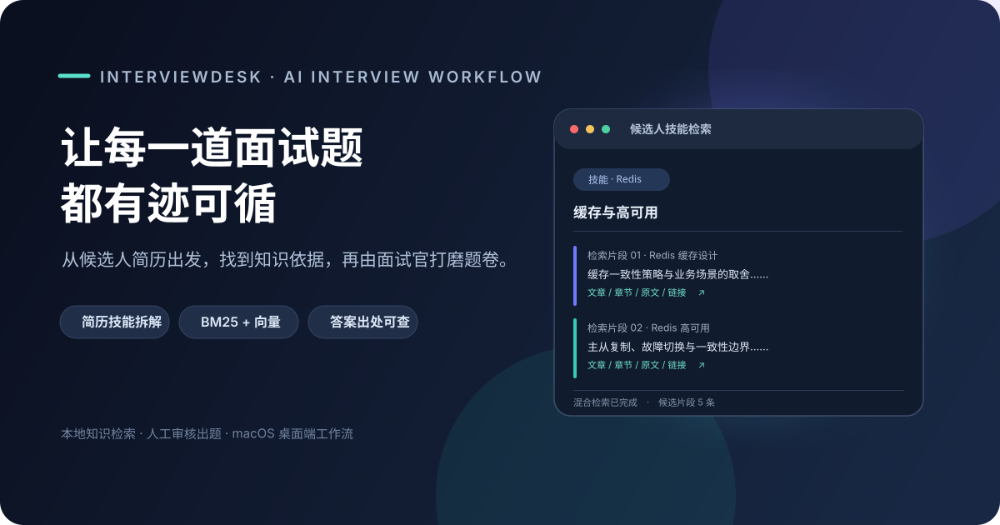

<div align="center">
  <h1>InterviewDesk · 面试题 RAG 服务</h1>
  <p>从候选人简历出发，检索有出处的技术知识，生成可复核的结构化面试题。</p>

  <p>
    
    
    
  </p>
</div>

## 项目介绍

这是 InterviewDesk 的本地知识检索后端。它读取结构化简历，围绕候选人的技能和项目经历，从技术文章语料中检索相关片段，并输出带有来源信息的检索包，供面试题整理和复核。

**它解决的问题：**面试准备不必每次从头翻文章、凭记忆出题。检索结果保留文章、章节、摘录和链接，方便核对；题目生成仍由面试官把关，减少模型补全语料外内容造成的误导。

```text
结构化简历 → 技能拆解 → BM25 + 向量混合检索 → 检索包（Markdown / JSON）
                                                   ↓
                                      人工整理题卷 → 注入 InterviewDesk
```

> 本仓库提供检索与题卷注入服务；题目内容由面试官根据检索材料编写、校验后再注入桌面端。

## 功能亮点

- **针对简历检索：**将技能点和经历证据拆成多个查询，减少一个宽泛关键词主导结果的情况。
- **混合召回：**BM25 负责关键词匹配，向量检索负责语义相近内容，使用 RRF 按排名融合并去重。
- **答案可追溯：**检索片段保留文件、标题层级、原文摘录和来源链接，便于检查依据。
- **面试官保留判断权：**自动化检索，人工编写与审核题目答案；覆盖语料外的内容明确标记，不把猜测当成标准答案。
- **可供桌面端调用：**`serve.py` 提供基于标准输入输出的逐行 JSON 服务协议，可作为 InterviewDesk 的内嵌进程。
- **题卷写入有备份：**`generate/inject.py` 写入桌面端题卷前会保存带时间戳的备份。

## 工作流程

1. 将候选人简历整理为 JSON，列出技能、熟练程度和项目证据。
2. 运行 `main.py`，得到每个技能对应的相关知识片段。
3. 查看 `data/retrieval_bundle.md`，据此整理题目、答案要点、考察点和追问，并检查来源。
4. 按题卷 schema 保存题卷，再运行注入脚本写入 InterviewDesk。

## 环境要求

- macOS（桌面端注入路径针对 macOS；检索脚本本身为 Python）
- Python 3.10 或更高版本
- 技术语料目录：`../crazymakercircle_blog/md/` 及其 `index.json`
- 首次构建向量索引时需要下载 `BAAI/bge-small-zh-v1.5` 模型（fastembed/ONNX Runtime）

## 快速开始

在项目目录中执行：

```bash
python3 -m venv .venv
source .venv/bin/activate
python -m pip install -r requirements.txt
```

第一次使用，或语料有更新时，构建分块和索引并检索样例简历：

```bash
python main.py --rebuild --resume resume/sample_xxx.json
```

索引已有时，日常只需运行检索：

```bash
python main.py --resume resume/sample_xxx.json
```

结果写入 `data/retrieval_bundle.md` 和 `data/retrieval_bundle.json`。默认简历文件为 `resume/sample_xxx.json`，也可以替换成自己的 JSON 路径：

```bash
python main.py --resume /path/to/candidate.json
```

### 简历数据格式

```json
{
  "name": "候选人",
  "skills": [
    {
      "name": "Redis",
      "level": "熟悉",
      "evidence": "缓存设计 持久化 高可用 项目中的使用和取舍"
    }
  ],
  "projects": [],
  "depth_signals": []
}
```

`evidence` 用空格分隔具体关键词。系统会将技能名与每个关键词组合成独立查询。当前版本接受结构化 JSON，尚未包含 PDF 简历解析。

## 桌面端检索服务协议

`serve.py` 从标准输入逐行读取 JSON，并向标准输出逐行返回 JSON。启动后可发送：

```json
{"action":"ping"}
```

返回服务状态和索引块数；执行检索时发送：

```json
{"action":"retrieve","resume":{"name":"候选人","skills":[{"name":"Redis","level":"熟悉","evidence":"缓存 持久化"}]}}
```

检索响应为 `{"ok":true,"bundle":[...]}`。错误响应为 `{"ok":false,"error":"..."}`。服务启动信息输出到标准错误，避免污染协议响应。

索引和模型缓存可通过 `RAG_DATA_DIR`、`RAG_CACHE_DIR` 指定，便于桌面应用或打包版本放置运行时数据。

## 题卷注入

题目由面试官根据检索包整理，`generate/inject.py` 负责校验并写入 InterviewDesk 的题卷文件。写入前脚本会备份现有文件。运行前请检查脚本中的题卷路径和输入 schema，确认与目标 InterviewDesk 版本一致：

```bash
python generate/inject.py
```

## 目录结构

```text
interview_app/
├── main.py                  # 简历 → 检索 → 输出检索包
├── serve.py                 # 桌面端内嵌 JSON 行协议服务
├── config.py                # 语料、数据目录和检索参数
├── corpus/
│   ├── clean.py             # 语料清理
│   ├── chunk.py             # 按章节切分并保留出处
│   └── index.py             # BM25 token 与向量索引构建
├── resume/                  # 简历解析和样例
├── retrieve/search.py       # BM25 + 向量混合检索、RRF 融合
├── generate/
│   ├── build_prompt.py      # 检索包 Markdown 格式化
│   └── inject.py            # 题卷校验、备份和注入
├── docs/architecture.md     # 详细架构与设计记录
└── data/                    # 本地索引及检索输出
```

## 检索参数

| 参数 | 默认值 | 作用 |
| --- | ---: | --- |
| `EMBED_MODEL` | `BAAI/bge-small-zh-v1.5` | 中文向量模型 |
| `BM25_TOPK` | 20 | 每个查询的 BM25 候选数 |
| `VEC_TOPK` | 20 | 每个查询的向量候选数 |
| `RRF_K` | 60 | 排名融合平滑参数 |
| `FINAL_TOPK` | 5 | 每个技能最终保留的片段数 |

更多实现细节、清洗规则、出处设计和限制见 [`docs/architecture.md`](docs/architecture.md)。

## 当前限制

- 简历输入需先整理为 JSON；没有内置 PDF 解析。
- 检索质量取决于本地语料的覆盖范围和质量，未检索到的知识不会自动补齐。
- 当前重建索引是全量操作，耗时主要来自首次下载模型和向量编码。
- `data/` 中的索引由语料构建，不适合提交大型二进制产物时可按团队发布方式管理。
- InterviewDesk 注入目标是本机用户目录，打包或迁移前需检查目标路径与题卷 schema。

## 设计原则

**让检索可复用，让答案可复核。**系统负责从简历定位可能相关的知识材料，出处和限制随检索结果保留下来；面试官负责判断题目是否贴合岗位、答案是否准确、追问是否能区分真实经验。
